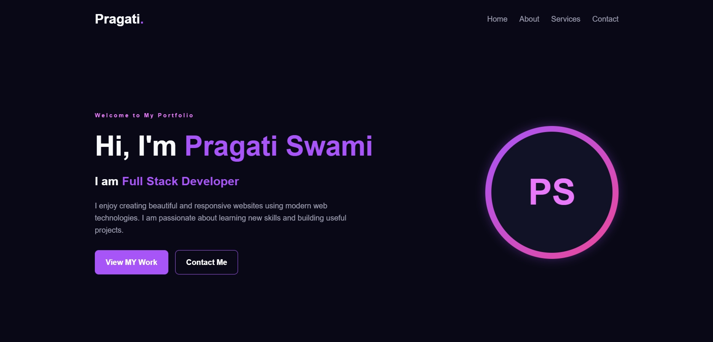
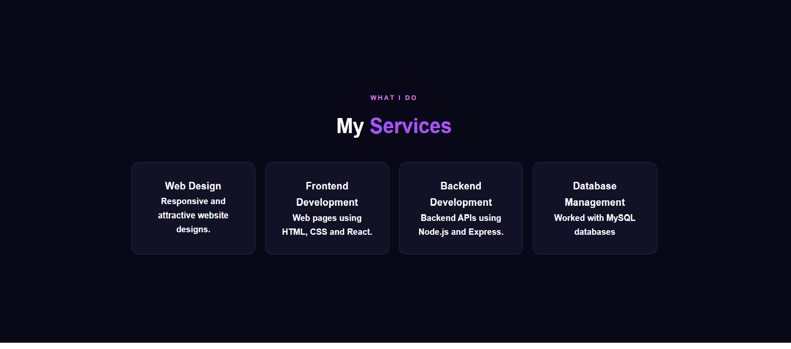
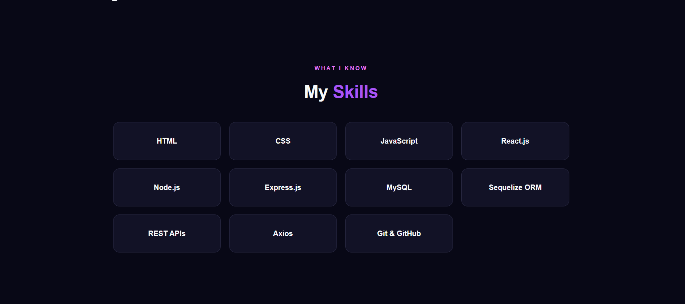
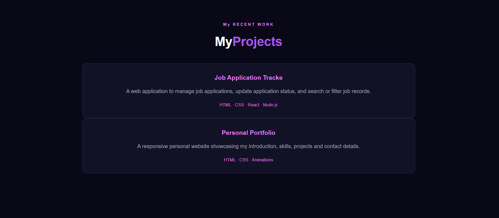

# ✨Pragati Swami — My Portfolio Website

Welcome to my personal portfolio website! 👋

I am an aspiring Full Stack Developer and a BCA student passionate about building responsive, user-friendly, and visually appealing web applications.

This portfolio showcases my introduction, technical skills, and developer journey.

## 🌐 Live Demo

🔗 **Portfolio Website:** [https://pragatiswami421.github.io/my-portfolio-website/](https://pragatiswami421.github.io/my-portfolio-website/)

## 📸 Portfolio Preview

### 1. Full Portfolio Preview


### 2. Portfolio Screenshot


### 3. Projects / Skills Preview


### 4. Additional Preview


## 🚀 Features

- Clean and modern user interface
- Animated website elements
- Responsive and visually appealing design
- Sections to introduce myself and showcase my skills
- Simple navigation between website sections

## 🛠️ Technologies Used

- **HTML5** — Website structure
- **CSS3** — Styling, layouts, and animations

## 📂 Project Structure

```text
my-portfolio-website/
├── index.html
└── style.css
```

## 💻 Run Locally

1. Clone this repository:

   ```bash
   git clone https://github.com/pragatiswami421/my-portfolio-website.git
   ```

2. Open the project folder.

3. Open `index.html` in your web browser.

## 🎯 Purpose

The purpose of this project is to create my online developer portfolio, practice frontend development, and showcase my skills and projects to potential employers.

## 👩‍💻 About Me

- **Name:** Pragati Swami
- **Career Interest:** Full Stack Development and React Development
- **Currently Learning:** Improving my web development and programming skills

## 📬 Connect With Me

- **GitHub:** [https://github.com/pragatiswami421](https://github.com/pragatiswami421)
- **LinkedIn:** [https://www.linkedin.com/in/pragati-swami-153190435/](https://www.linkedin.com/in/pragati-swami-153190435/)

---

⭐ Thank you for visiting my portfolio repository!

*Built with HTML and CSS by Pragati Swami.*
